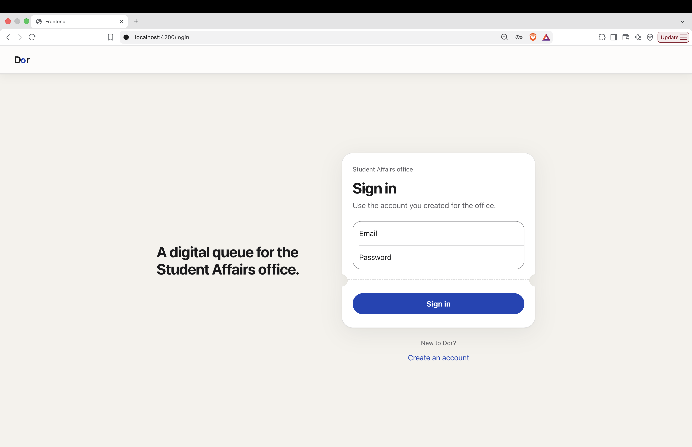
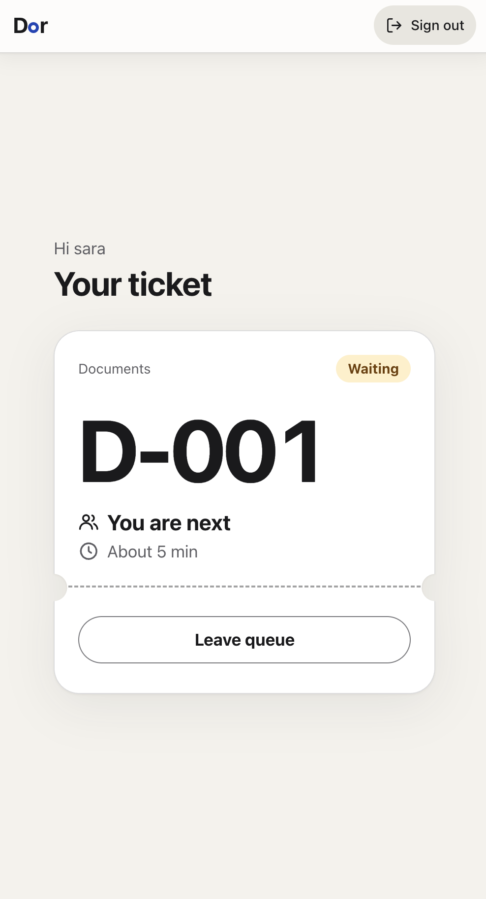
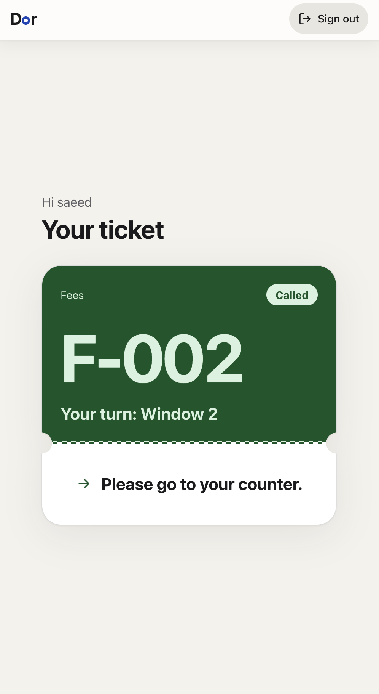
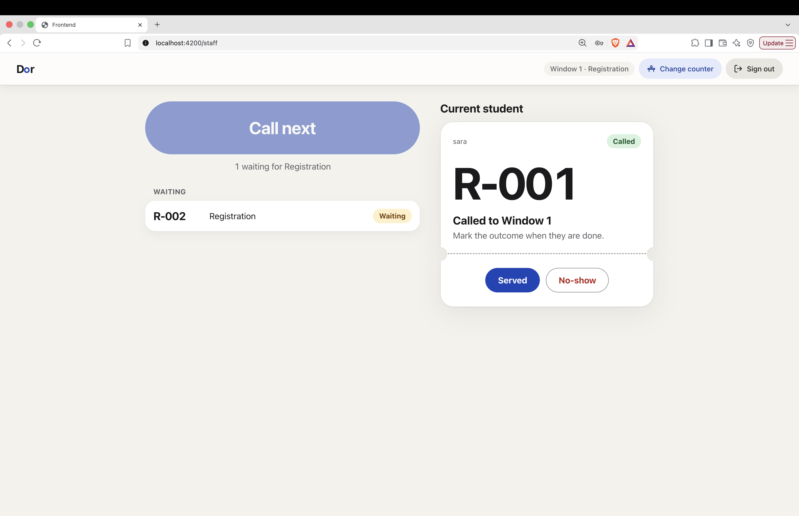
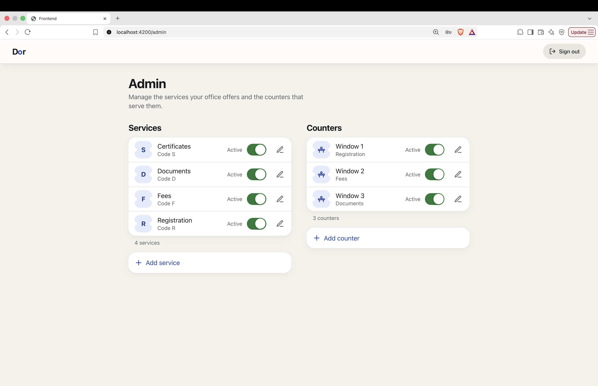
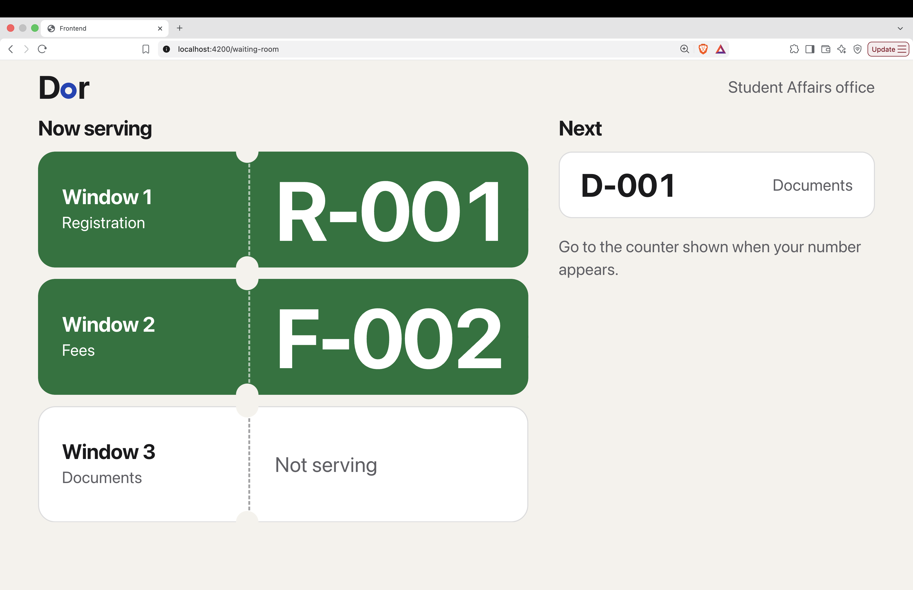

# Dor: Smart Queue System

Dor is a digital queue for a university Student Affairs office. Paper queue numbers give students no information about their place in line and no way to leave the office while they wait. With Dor, a student takes a ticket on their phone, sees how many people are ahead, and is called to a counter by staff. A public screen in the waiting room shows who is being served.

## Features of Release 1

**Student**

- Register and log in.
- Take a ticket for a service. A student can have only one active ticket (waiting or called) at a time. After it is done, no-show or cancelled, the student can take another. The ticket code looks like `R-001` and is numbered per service per day. A ticket can only be taken when the service has an open counter.
- See how many people are ahead and an estimated wait (a fixed 5 minutes per person).
- See when the ticket is called and which counter to go to.
- Leave the queue while the ticket is still waiting.

**Staff**

- Choose a counter.
- Call the next student.
- See the current student and the waiting list (the first 20 tickets).
- Mark the current student as done or no-show.

**Admin**

- Create, edit, turn on and turn off services (a name and a code of 1 or 2 letters).
- Create, edit, turn on and turn off counters. Each counter belongs to one service.

**Waiting screen** (`/waiting-room`, no login)

- Shows who is being served at each open counter.
- Shows the next 3 tickets and how many more are waiting.
- Built for a TV screen.

The student ticket screen and the waiting screen refresh by asking the server every 5 seconds. The staff desk refreshes only its waiting list every 5 seconds. The admin, login and register screens do not refresh by themselves.

**Planned for Release 2:** live updates, early alerts, statistics, and admin user management (changing roles from the screen).

## Tech stack

| Layer    | Technology                                           |
| -------- | ---------------------------------------------------- |
| Frontend | Angular 22 (standalone components, signals), Vitest  |
| Backend  | Java 21, Spring Boot 4.1.2, Spring Security with JWT |
| Database | PostgreSQL                                           |

Not yet in the project: Flyway migrations, Docker Compose, GitHub Actions. The tables are created automatically by Hibernate (`ddl-auto=update`).

## How to run

You need Java 21, PostgreSQL (running), and Node 26.9.0 with npm.

### 1. Clone

```bash
git clone https://github.com/Sara-H-Samara/dor-smart-queue.git
cd dor-smart-queue
```

### 2. Create the databases

```bash
createdb <database-name>
createdb dor_test
```

`dor_test` is only used by the backend tests.

### 3. Backend

The file `application.properties` is not in the repository. Copy the example and fill in your database user and password:

```bash
cp backend/src/main/resources/application.properties.example backend/src/main/resources/application.properties
```

Set these environment variables before you start the backend:

| Name                     | Meaning                                                |
| ------------------------ | ------------------------------------------------------ |
| `JWT_SECRET`             | Secret that signs the login tokens. It must be Base64. |
| `JWT_EXPIRATION_MINUTES` | How long a login token is valid, in minutes.           |
| `ADMIN_PASSWORD`         | Password of the seeded admin account.                  |
| `STAFF_PASSWORD`         | Password of the seeded staff account.                  |

To make a Base64 secret:

```bash
openssl rand -base64 32
```

Then start the server:

```bash
cd backend
./mvnw spring-boot:run
```

The backend runs on `http://localhost:8080`. The admin and staff accounts are created on the first start.

### 4. Frontend

```bash
cd frontend
npm install
npm start
```

Open `http://localhost:4200`. The development build calls the backend at `http://localhost:8080`.

### 5. Tests

**Backend.** The tests use the `test` profile and the `dor_test` database, so PostgreSQL must be running. The tables are created for the tests and dropped after (`create-drop`), so the tests do not touch your development data.

You need both settings files. The test file only sets the database URL (`dor_test`). The database user and password come from the main `application.properties` (step 3). Copy the test example too:

```bash
cp backend/src/test/resources/application-test.properties.example backend/src/test/resources/application-test.properties
```

Set the same environment variables as in step 3, then run:

```bash
cd backend
./mvnw test
```

**Frontend.**

```bash
cd frontend
npm test
```

## How to use it: one student visit

1. Log in as the admin. Create a service (for example name `Course registration`, code `R`) and a counter for it.
2. Log in as the staff user. Choose the counter.
3. Open `http://localhost:4200/waiting-room` on another screen or tab.
4. Register as a student and log in. Choose the service and take a ticket. The ticket shows the people ahead and the estimated wait. The waiting screen shows the ticket under the next tickets.
5. As staff, press **Call next**. The student's ticket changes to called and shows the counter. The waiting screen shows the ticket at that counter.
6. As staff, press **Done**, or **No-show** if the student does not come.

## Test accounts

| Role  | Email           |
| ----- | --------------- |
| Admin | `admin@dor.com` |
| Staff | `staff@dor.com` |

The passwords are the values you set in `ADMIN_PASSWORD` and `STAFF_PASSWORD`. Students register themselves.

## Project structure

```text
backend/src/main/java/com/sara/backend/
  configurations/   security, CORS, and the seeded accounts
  controllers/      HTTP endpoints
  services/         business rules (implementations/ holds the classes)
  repositories/     database access
  entities/         database tables
  dtos/             requests/ and responses/
  exceptions/       error responses
  security/         JWT creation and checking
frontend/src/app/
  core/             guards, interceptors, models, services
  features/         auth, student, staff, admin, waiting-screen
  shared/           parts used by several screens
```

## API overview

| Who     | Endpoints                                                                                                                                                                                                              |
| ------- | ---------------------------------------------------------------------------------------------------------------------------------------------------------------------------------------------------------------------- |
| Public  | `POST /api/auth/register`, `POST /api/auth/login`, `GET /api/public/queue-status`, `GET /api/public/queue-stream`                                                                                                      |
| Student | `GET /api/services`, `POST /api/tickets`, `GET /api/tickets/me`, `POST /api/tickets/me/cancel`, `GET /api/tickets/me/stream`                                                                                           |
| Staff   | `GET /api/counters`, `POST /api/counters/{id}/call-next`, `GET /api/counters/{id}/current`, `GET /api/counters/{id}/waiting`, `POST /api/tickets/{id}/done`, `POST /api/tickets/{id}/no-show`, `GET /api/staff/stream` |
| Admin   | `GET /api/counters`, `GET /api/admin/stream`, and `GET`, `POST`, `PUT /{id}`, `PATCH /{id}/active` on `/api/admin/services` and `/api/admin/counters`                                                                  |

Protected endpoints need the header `Authorization: Bearer <token>`. See [API.md](API.md) for every endpoint with examples.

## Known limitations

- There is no rate limit on login and register.
- Staff are not tied to a counter. Any staff member can use any counter and can mark any ticket as done or no-show.
- When an admin turns a service off, the tickets already waiting stay waiting. They disappear from the waiting screen and cannot be called. The student still sees the ticket and can leave the queue. If the service is turned on again, they come back.
- There is no end-of-day close. Tickets belong to a date, and old waiting tickets are simply ignored the next day.
- "Today" is the date of the server, so the server time zone decides when the ticket numbers start again.
- The estimated wait is a fixed 5 minutes per person.
- Refreshing is by asking the server every 5 seconds, only on the student ticket screen, the waiting screen and the staff waiting list. The server can already send live updates (see [API.md](API.md#live-updates)), but the screens do not use them yet.
- Live updates have no limit on the number of open streams, in total or for one user.
- Live updates work with one server only. The open streams are kept in the memory of that server, so a second server would not tell the screens connected to the first.
- A live stream sends only a signal that something changed. The screen must ask the server for the data. Events that came while a screen was disconnected are not sent again.
- There is no user management on the screen. Staff and admin accounts come only from the seed.

## Screenshots

| Screen                       | File                              |
| ---------------------------- | --------------------------------- |
| Login                        | `screenshots/login.png`           |
| Student: ticket waiting      | `screenshots/student-waiting.png` |
| Student: ticket called       | `screenshots/student-called.png`  |
| Staff desk                   | `screenshots/staff-desk.png`      |
| Admin: services and counters | `screenshots/admin.png`           |
| Waiting screen               | `screenshots/waiting-screen.png`  |

### Login



### Student: ticket waiting



### Student: ticket called



### Staff desk



### Admin: services and counters



### Waiting screen



## License

MIT
