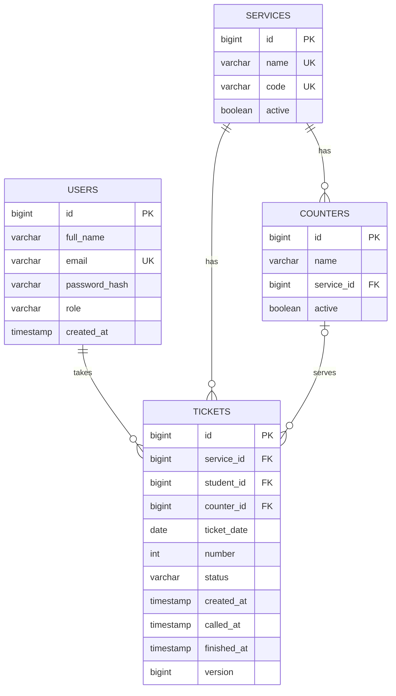

# Dor: Database Design (Sprint 1)

## Tables and relations

## users

| Column | Type | Rules | Why |
|---|---|---|---|
| id | bigint | Primary key | Identifies each user |
| full_name | varchar(100) | Required | Shown on screens |
| email | varchar(150) | Required, unique | Used to log in (US1) |
| password_hash | varchar(255) | Required | Encrypted password, never plain text (US1) |
| role | varchar(20) | STUDENT, STAFF, or ADMIN | Decides what the user can do (US2) |
| created_at | timestamp | Required | When the account was created |

## services

| Column | Type | Rules | Why |
|---|---|---|---|
| id | bigint | Primary key | Identifies each service |
| name | varchar(100) | Required, unique | For example, "Course registration" (US3) |
| code | varchar(2) | Required, unique, capital letters | Prefix of the ticket number, for example R (US3, US5) |
| active | boolean | Default true | Students see only active services (US3) |

## counters

| Column | Type | Rules | Why |
|---|---|---|---|
| id | bigint | Primary key | Identifies each counter |
| name | varchar(50) | Required | For example, "Desk 1" (US4) |
| service_id | bigint | Foreign key to services | Each counter belongs to one service (US4) |
| active | boolean | Default true | Inactive counters are hidden (US4) |

## tickets

| Column | Type | Rules | Why |
|---|---|---|---|
| id | bigint | Primary key | Identifies each ticket |
| service_id | bigint | Foreign key to services | The service the student is waiting for (US5) |
| student_id | bigint | Foreign key to users | The student who took the ticket (US5) |
| counter_id | bigint | Foreign key to counters, empty until called | The desk that called the student (US8) |
| ticket_date | date | Required | Numbers restart each day (US5) |
| number | int | Required | The number shown to the student (US5) |
| status | varchar(20) | WAITING, CALLED, DONE, ABSENT, or CANCELLED | Where the ticket is in its life (US5 to US9) |
| created_at | timestamp | Required | Order of the line: oldest waiting is called first (US8) |
| called_at | timestamp | Empty until called | Start of service, used for the average (US6) |
| finished_at | timestamp | Empty until the ticket ends | End of service, used for the average (US6) |
| version | bigint | Starts at 0 | Two desks never get the same ticket (US10) |

**Unique rule:** (service_id, ticket_date, number) is unique, so the same number can't be
given twice in the same service on the same day.

**Ticket shown to the student:** the service code, a dash, and the number in three digits,
for example R-001. It is built when the ticket is displayed, not stored in the table.

**One active ticket per student** (US5) is checked by the server before a ticket is
created.
